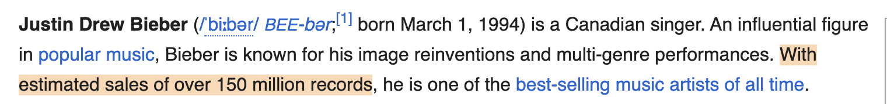

# receipts

**Make Claude show its receipts.** When Claude cites a web page, this plugin checks that the quote is really there, links straight to it, and shows you the passage, so you never have to open a link and hunt for it yourself.



It works in the docs Claude writes (specs, design notes, READMEs) and in its answers in chat.

## What you get

Without the plugin, a citation is a link and a paraphrase. With it, every citation comes with:

- **The exact words from the page.** Each quote is checked against the live page, word for word. A quote that's slightly off is replaced with what the page actually says.
- **A link that lands on the quote.** Clicking it scrolls to the passage and highlights it.
- **An optional screenshot** of the passage, highlighted, cropped how you ask.

This is what an answer in chat looks like:

> Clients must not cache rate-limit responses:
>
> > Responses with the 429 status code MUST NOT be stored by a cache.
> > — [Additional HTTP Status Codes — 4. 429 Too Many Requests](https://www.rfc-editor.org/rfc/rfc6585.html#:~:text=Responses%20with%20the%20429%20status%20code%20MUST%20NOT%20be%20stored%20by%20a%20cache.)

In a markdown file, the same proof goes in a footnote instead, with the date it was checked.

If a page can't be checked (a PDF, a login page), Claude says so and marks the claim **UNVERIFIED** instead of quoting from memory.

## Try it

After [installing](#install), paste any of these into Claude Code.

**Ask a question, get checked sources**

```text
What does the HTTP spec say about caching 429 responses? Give me sources I can check.
```

```text
What can the Retry-After header contain? Quote MDN and the RFC.
```

```text
Is this quote real? "With estimated sales of over 150 million records", from Wikipedia's Justin Bieber article.
```

**Write or fix a doc**

```text
Write a short design note in docs/rate-limits.md on whether our API should return 429 with Retry-After. Cite the RFCs.
```

```text
Go through docs/spec.md and add verified sources for every claim about external standards or APIs.
```

**Add screenshots**

```text
Explain how HTTP caching works with ETags, with sources and tight screenshots of each quote.
```

```text
Same note, but make the screenshots mobile-sized and in dark mode.
```

```text
Add screenshots that show the whole section around each quote.
```

## Install

In Claude Code:

```text
/plugin marketplace add alanchoi00/receipts
/plugin install receipts@receipts
```

The first time Claude uses the plugin, it installs a headless browser (Playwright's Chromium, about 100 MB). That takes about a minute and only happens once. You need Node 18 or later.

**Getting updates:** turn on auto-update in `/plugin` → **Marketplaces** → **receipts** → **Enable auto-update**, or update by hand with `/plugin marketplace update receipts`.

## Screenshot options

Screenshots are off unless you ask, because they roughly double the time. When you ask, describe what you want in plain words:

| Say | You get |
|---|---|
| "with screenshots" | The paragraph containing the quote |
| "tight screenshots" | Just the quoted lines |
| "show the whole section" | Everything from the section heading down |
| "full-screen screenshots" | The whole browser window around the quote |
| "a couple of lines around it" | Extra lines above and below |
| "mobile-sized" | A phone-width page |
| "dark mode" | The site's dark theme, if it has one |
| "keep them short" / "smaller images" | Shorter crops / smaller files |
| "highlight in yellow" / "no highlight" | A different highlight color / none |

You can see every option, with a real screenshot, in [`examples/README.md`](examples/README.md).

In a doc, screenshots are saved to a `refs/` folder next to it. In chat, they go to a temporary folder and Claude gives you the file paths.

## Make it the default

In chat, Claude only checks sources when you ask for them, because each check opens the page in a browser. To always get checked sources in a project, add this line to its `CLAUDE.md`:

```text
When an answer relies on web pages, cite them with the receipts skill.
```

## Good to know

- **HTML pages only.** PDFs and downloads can't be checked.
- **No logins.** Pages behind a login or paywall can't be checked and are marked UNVERIFIED.
- **Internal pages work.** Docs on your company network can be cited. Claude flags them as internal and quotes only what's needed.
- **A citation is a snapshot.** It shows what the page said when it was checked. Nothing re-checks it later.
- **Highlighted links** work in current Chrome, Edge, Safari and Firefox. Older browsers just open the page.

## For contributors

The plugin is one skill, [`skills/citing-sources-with-excerpts`](skills/citing-sources-with-excerpts): instructions for Claude in `SKILL.md`, and a script, `scripts/snap.mjs`, that does the checking. You can run the script on its own:

```bash
# check one quote
node skills/citing-sources-with-excerpts/scripts/snap.mjs "https://en.wikipedia.org/wiki/Justin_Bieber" \
  --quote "With estimated sales of over 150 million records" --out bieber.png

# check many quotes with one browser
node skills/citing-sources-with-excerpts/scripts/snap.mjs --batch cites.json   # [{"url", "quote", "out"?}]
```

It prints JSON with the match type (`exact`, `loose`, `fuzzy` or `none`), the quote as it appears on the page, the highlight link, the surrounding paragraph, the page title and section, and the screenshot path.

[`examples/`](examples) holds 46 edge cases, from repeated text and collapsed sections to login walls, blocked URLs and wide tables. One command runs them all and regenerates [`examples/README.md`](examples/README.md):

```bash
node examples/build.mjs            # run every case, regenerate the page and screenshots
node examples/build.mjs --check    # smoke test: verify only, write nothing
node examples/build.mjs --offline  # skip the cases that need live websites
```

Issues and pull requests are welcome. Please run `node examples/build.mjs --check` before opening a PR, and add a case to `examples/cases.json` for any new behavior.

## License

[MIT](LICENSE)
