# Examples and edge cases

Every case below is generated by [`build.mjs`](build.mjs) from [`cases.json`](cases.json): it runs the input through `snap.mjs`, checks the result against what the case expects, and opens every generated link in Chromium to confirm it really jumps to the quote.

Cases marked 🌐 use live websites; the rest use small local pages in [`fixtures/`](fixtures), served from `http://127.0.0.1:4317` (so their links only work while `build.mjs` is running).

```bash
node examples/build.mjs            # regenerate this page
node examples/build.mjs --check    # smoke test: verify only, write nothing
node examples/build.mjs --offline  # skip the 🌐 cases
```

Last run: 2026-11-08 · 48/48 cases pass.

## Finding the quote

| Case | Result | Pass |
|---|---|---|
| [🌐 Exact quote](#exact) | `exact` | ✅ |
| [Curly quotes and dashes](#punctuation-normalized) | `exact` | ✅ |
| [Only punctuation differs](#punctuation-loose) | `loose` | ✅ |
| [🌐 Paraphrased quote](#fuzzy) | `fuzzy` | ✅ |
| [Quote not on the page](#not-found) | `none` | ✅ |
| [🌐 Quote crosses a link and inline code](#crosses-link) | `exact` | ✅ |
| [Footnote marker inside the quote](#footnote-marker) | `exact` | ✅ |
| [🌐 Plain-text page with hard line wraps](#line-wraps) | `exact` | ✅ |
| [Same text twice, no hint](#duplicate-first) | `exact`, occurrence 1 of 2 | ✅ |
| [Same text twice, picked with prefix](#duplicate-prefix) | `exact`, occurrence 2 of 2 | ✅ |
| [Quote spans lines split by <br>](#line-breaks) | `exact` | ✅ |
| [Repeated text next to a <br>](#line-breaks-pinned) | `exact`, occurrence 1 of 2 | ✅ |
| [Very long quote](#long-quote) | `exact` | ✅ |
| [🌐 Quote contains - and ,](#special-characters) | `exact` | ✅ |
| [Quote inside a collapsed section](#collapsed-details) | `exact` | ✅ |
| [Quote inside an inactive tab](#inactive-tab) | `exact`, hidden | ✅ |
| [Text added by JavaScript after load](#js-rendered) | `exact` | ✅ |
| [Japanese text](#non-latin) | `exact` | ✅ |
| [Emoji in the quote](#emoji) | `exact` | ✅ |

<a id="exact"></a>
### 🌐 Exact quote

The common case. Also shows the crop skipping the floating infobox next to the paragraph.

<details><summary>Input</summary>

```json
{
  "url": "https://en.wikipedia.org/wiki/Justin_Bieber",
  "quote": "With estimated sales of over 150 million records",
  "out": "refs/exact.png"
}
```

</details>

**match:** `exact` · **link:** highlights the quote in Chromium

What the skill writes:

```md
[^exact]: > With estimated sales of over 150 million records
    >
    > — [Justin Bieber - Wikipedia](https://en.wikipedia.org/wiki/Justin_Bieber#:~:text=With%20estimated%20sales%20of%20over%20150%20million%20records) · retrieved 2026-11-08
    >
    > 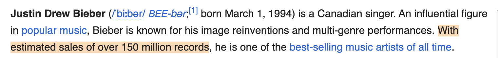
```


<a id="punctuation-normalized"></a>
### Curly quotes and dashes

The page uses “curly quotes” and an em dash; the quote uses straight quotes and a hyphen. These count as the same text.

<details><summary>Input</summary>

```json
{
  "url": "http://127.0.0.1:4317/punctuation.html",
  "quote": "The header is called \"Retry-After\" - not \"Retry\"."
}
```

</details>

**match:** `exact` · **internal:** true · **link:** highlights the quote in Chromium

What the skill writes:

```md
[^punctuation-normalized]: > The header is called “Retry-After” — not “Retry”.
    >
    > — [Header naming](http://127.0.0.1:4317/punctuation.html#:~:text=The%20header%20is%20called%20%E2%80%9CRetry%2DAfter%E2%80%9D%20%E2%80%94%20not%20%E2%80%9CRetry%E2%80%9D.) · retrieved 2026-11-08
```

<a id="punctuation-loose"></a>
### Only punctuation differs

Page says “rate-limited”, quote says “rate limited”. Still word for word, so `loose`, not `fuzzy`.

<details><summary>Input</summary>

```json
{
  "url": "http://127.0.0.1:4317/punctuation.html",
  "quote": "Requests are rate limited per API key"
}
```

</details>

**match:** `loose` · **internal:** true · **link:** highlights the quote in Chromium

What the skill writes:

```md
[^punctuation-loose]: > Requests are rate-limited per API key
    >
    > — [Header naming](http://127.0.0.1:4317/punctuation.html#:~:text=Requests%20are%20rate%2Dlimited%20per%20API%20key) · retrieved 2026-11-08
```

<a id="fuzzy"></a>
### 🌐 Paraphrased quote

The quote is not on the page. The script returns the closest real sentence, which Claude must use instead.

<details><summary>Input</summary>

```json
{
  "url": "https://en.wikipedia.org/wiki/Justin_Bieber",
  "quote": "Bieber is one of the best selling music artists ever, with over 150 million records sold"
}
```

</details>

**match:** `fuzzy` · **link:** highlights the quote in Chromium

**note:** Quote not on page verbatim; closest sentence (overlap 0.81). Use quote_on_page, not the original quote.

What the skill writes:

```md
[^fuzzy]: > With estimated sales of over 150 million records, he is one of the best-selling music artists of all time.
    >
    > — [Justin Bieber - Wikipedia](https://en.wikipedia.org/wiki/Justin_Bieber#:~:text=With%20estimated%20sales%20of%20over%20150%20million%20records%2C%20he%20is%20one%20of%20the%20best%2Dselling%20music%20artists%20of%20all%20time.) · retrieved 2026-11-08
```

<a id="not-found"></a>
### Quote not on the page

Nothing close enough. Claude marks the claim UNVERIFIED.

<details><summary>Input</summary>

```json
{
  "url": "http://127.0.0.1:4317/article.html",
  "quote": "Rate limits are disabled for enterprise customers"
}
```

</details>

**match:** `none`, not on the page

<a id="crosses-link"></a>
### 🌐 Quote crosses a link and inline code

The sentence contains a link styled as code. Also shows a sticky site header not covering the crop.

<details><summary>Input</summary>

```json
{
  "url": "https://developer.mozilla.org/en-US/docs/Web/HTTP/Reference/Headers/Retry-After",
  "quote": "In a 429 Too Many Requests response, this indicates how long to wait before making a new request.",
  "out": "refs/crosses-link.png"
}
```

</details>

**match:** `exact` · **link:** highlights the quote in Chromium

What the skill writes:

```md
[^crosses-link]: > In a 429 Too Many Requests response, this indicates how long to wait before making a new request.
    >
    > — [Retry-After header - HTTP | MDN](https://developer.mozilla.org/en-US/docs/Web/HTTP/Reference/Headers/Retry-After#:~:text=In%20a%20429%20Too%20Many%20Requests%20response%2C%20this%20indicates%20how%20long%20to%20wait%20before%20making%20a%20new%20request.) · retrieved 2026-11-08
    >
    > 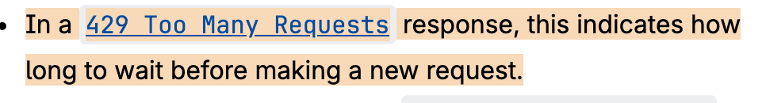
```


<a id="footnote-marker"></a>
### Footnote marker inside the quote

The page has a [1] marker mid-sentence; the quote doesn't. It still matches, and the link switches to the start,end form so browsers highlight across the marker.

<details><summary>Input</summary>

```json
{
  "url": "http://127.0.0.1:4317/footnotes.html",
  "quote": "2.5 billion requests per day across 40 regions",
  "out": "refs/footnote-marker.png"
}
```

</details>

**match:** `exact` · **internal:** true · **link:** highlights the quote in Chromium

What the skill writes:

```md
[^footnote-marker]: > 2.5 billion requests per day across 40 regions
    >
    > — [Scale](http://127.0.0.1:4317/footnotes.html#:~:text=2.5%20billion%20requests%20per%20day,across%2040%20regions) · retrieved 2026-11-08
    >
    > 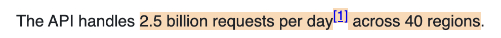
```


<a id="line-wraps"></a>
### 🌐 Plain-text page with hard line wraps

RFCs are preformatted text wrapped at 72 columns. The quote spans wrapped lines, and the crop centers on it inside a very tall block.

<details><summary>Input</summary>

```json
{
  "url": "https://www.rfc-editor.org/rfc/rfc6585.html",
  "quote": "The response representations SHOULD include details explaining the condition, and MAY include a Retry-After header indicating how long to wait before making a new request.",
  "out": "refs/line-wraps.png"
}
```

</details>

**match:** `exact` · **link:** highlights the quote in Chromium

What the skill writes:

```md
[^line-wraps]: > The response representations SHOULD include details explaining the condition, and MAY include a Retry-After header indicating how long to wait before making a new request.
    >
    > — [Additional HTTP Status Codes — 4. 429 Too Many Requests](https://www.rfc-editor.org/rfc/rfc6585.html#:~:text=The%20response%20representations%20SHOULD%20include,before%20making%20a%20new%20request.) · retrieved 2026-11-08
    >
    > 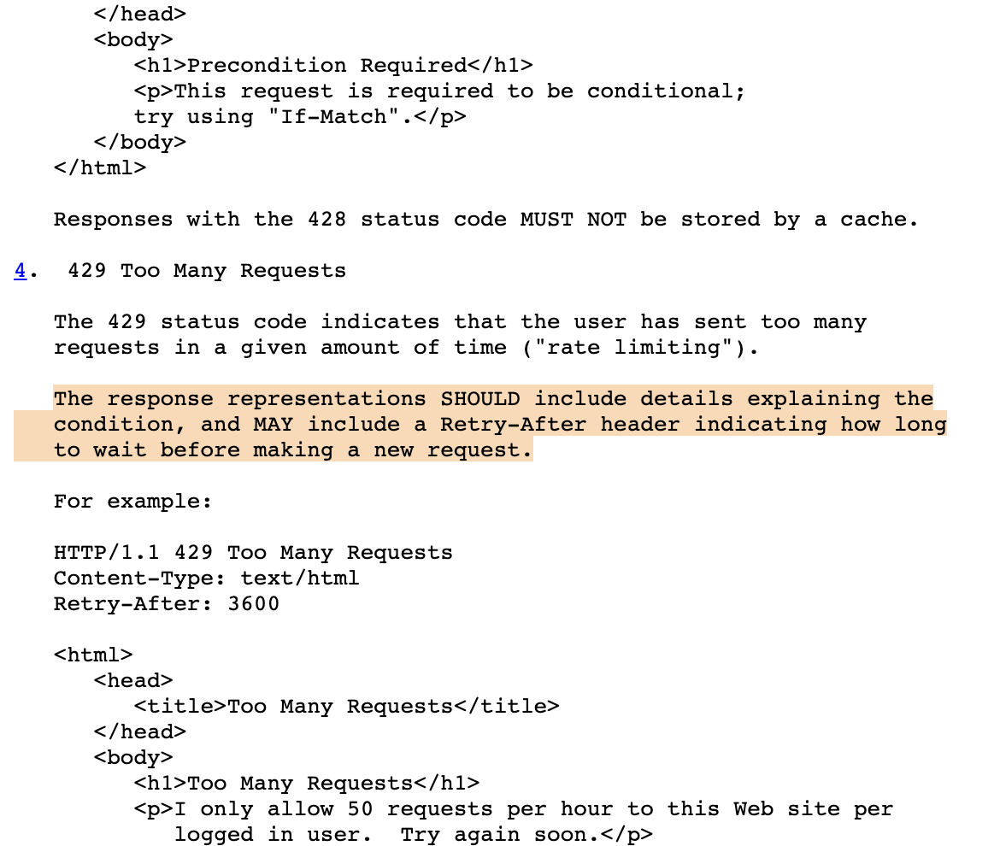
```


<a id="duplicate-first"></a>
### Same text twice, no hint

The sentence appears in two sections. Without a hint the script takes the first, says so, and pins the link to that occurrence with the words before and after it.

<details><summary>Input</summary>

```json
{
  "url": "http://127.0.0.1:4317/duplicate.html",
  "quote": "the default timeout is 30 seconds"
}
```

</details>

**match:** `exact` · **internal:** true · **occurrence:** 1 of 2 · **link:** highlights the quote in Chromium

**note:** Quote appears 2 times; matched the first. If you meant another, re-run with prefix/suffix (words just before/after it).

What the skill writes:

```md
[^duplicate-first]: > the default timeout is 30 seconds
    >
    > — [Timeouts — Client](http://127.0.0.1:4317/duplicate.html#:~:text=On%20the%20client%2C-,the%20default%20timeout%20is%2030%20seconds,-.%20It%20can) · retrieved 2026-11-08
```

<a id="duplicate-prefix"></a>
### Same text twice, picked with prefix

`prefix` selects the second occurrence; the screenshot highlights that one.

<details><summary>Input</summary>

```json
{
  "url": "http://127.0.0.1:4317/duplicate.html",
  "quote": "the default timeout is 30 seconds",
  "prefix": "On the server,",
  "out": "refs/duplicate-prefix.png"
}
```

</details>

**match:** `exact` · **internal:** true · **occurrence:** 2 of 2 · **link:** highlights the quote in Chromium

**note:** Picked occurrence 2 of 2 using prefix/suffix.

What the skill writes:

```md
[^duplicate-prefix]: > the default timeout is 30 seconds
    >
    > — [Timeouts — Server](http://127.0.0.1:4317/duplicate.html#:~:text=On%20the%20server%2C-,the%20default%20timeout%20is%2030%20seconds,-.%20It%20cannot) · retrieved 2026-11-08
    >
    > 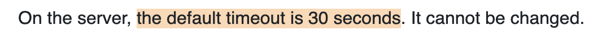
```


<a id="line-breaks"></a>
### Quote spans lines split by <br>

Fact boxes often put each line in one paragraph separated by <br>. The lines count as separate, so the quote reads with a space between them, and the link uses one start and one end piece, each within a single line, because browsers won't match a piece across a line break.

<details><summary>Input</summary>

```json
{
  "url": "http://127.0.0.1:4317/facts.html",
  "quote": "FULL NAME: Ada Example BORN: March 1, 1994",
  "out": "refs/line-breaks.png"
}
```

</details>

**match:** `exact` · **internal:** true · **link:** highlights the quote in Chromium

What the skill writes:

```md
[^line-breaks]: > FULL NAME: Ada Example BORN: March 1, 1994
    >
    > — [Ada Example](http://127.0.0.1:4317/facts.html#:~:text=FULL%20NAME%3A%20Ada%20Example,BORN%3A%20March%201%2C%201994) · retrieved 2026-11-08
    >
    > 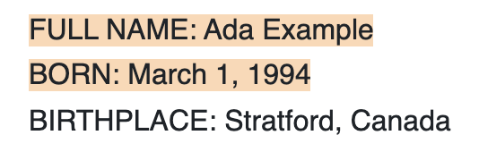
```

" width="720">

<a id="line-breaks-pinned"></a>
### Repeated text next to a <br>

The date appears twice. The words pinning the link to the first one come from the same line ("BORN:"), never glued across the line break ("Ada ExampleBORN:"), which no browser would match.

<details><summary>Input</summary>

```json
{
  "url": "http://127.0.0.1:4317/facts.html",
  "quote": "March 1, 1994"
}
```

</details>

**match:** `exact` · **internal:** true · **occurrence:** 1 of 2 · **link:** highlights the quote in Chromium

**note:** Quote appears 2 times; matched the first. If you meant another, re-run with prefix/suffix (words just before/after it).

What the skill writes:

```md
[^line-breaks-pinned]: > March 1, 1994
    >
    > — [Ada Example](http://127.0.0.1:4317/facts.html#:~:text=BORN%3A-,March%201%2C%201994) · retrieved 2026-11-08
```

<a id="long-quote"></a>
### Very long quote

Over 160 characters, so the link uses the short start,end form instead of the whole sentence.

<details><summary>Input</summary>

```json
{
  "url": "http://127.0.0.1:4317/long.html",
  "quote": "Request logs are kept for 30 days in hot storage, where they can be searched from the dashboard, and are then moved to cold storage for a further 335 days, after which they are permanently deleted unless a legal hold has been placed on the account by the compliance team."
}
```

</details>

**match:** `exact` · **internal:** true · **link:** highlights the quote in Chromium

What the skill writes:

```md
[^long-quote]: > Request logs are kept for 30 days in hot storage, where they can be searched from the dashboard, and are then moved to cold storage for a further 335 days, after which they are permanently deleted unless a legal hold has been placed on the account by the compliance team.
    >
    > — [Data retention](http://127.0.0.1:4317/long.html#:~:text=Request%20logs%20are%20kept%20for,account%20by%20the%20compliance%20team.) · retrieved 2026-11-08
```

<a id="special-characters"></a>
### 🌐 Quote contains - and ,

These characters are syntax in text-fragment links, so they must be encoded (%2D, %2C).

<details><summary>Input</summary>

```json
{
  "url": "https://www.rfc-editor.org/rfc/rfc9110.html",
  "quote": "A delay-seconds value is a non-negative decimal integer, representing time in seconds."
}
```

</details>

**match:** `exact` · **link:** highlights the quote in Chromium

What the skill writes:

```md
[^special-characters]: > A delay-seconds value is a non-negative decimal integer, representing time in seconds.
    >
    > — [RFC 9110: HTTP Semantics — 10.2.3. Retry-After](https://www.rfc-editor.org/rfc/rfc9110.html#:~:text=A%20delay%2Dseconds%20value%20is%20a%20non%2Dnegative%20decimal%20integer%2C%20representing%20time%20in%20seconds.) · retrieved 2026-11-08
```

<a id="collapsed-details"></a>
### Quote inside a collapsed section

The text is inside a closed <details>. The script finds it, expands the section, and screenshots it.

<details><summary>Input</summary>

```json
{
  "url": "http://127.0.0.1:4317/hidden.html",
  "quote": "Retries use exponential backoff with full jitter",
  "out": "refs/collapsed-details.png"
}
```

</details>

**match:** `exact` · **internal:** true · **link:** highlights the quote in Chromium

**note:** Quote was inside collapsed content; it was expanded for the screenshot.

What the skill writes:

```md
[^collapsed-details]: > Retries use exponential backoff with full jitter
    >
    > — [Advanced settings](http://127.0.0.1:4317/hidden.html#:~:text=Retries%20use%20exponential%20backoff%20with%20full%20jitter) · retrieved 2026-11-08
    >
    > 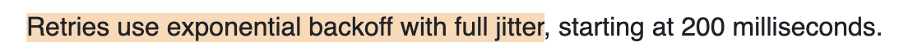
```


<a id="inactive-tab"></a>
### Quote inside an inactive tab

The text exists but is display:none. It counts as found and is flagged `hidden`; no screenshot is possible.

<details><summary>Input</summary>

```json
{
  "url": "http://127.0.0.1:4317/hidden.html",
  "quote": "In Go, set the MaxRetries field on the client config.",
  "out": "refs/inactive-tab.png"
}
```

</details>

**match:** `exact` · **internal:** true · **hidden:** true

**note:** Quote is in hidden content (e.g. an inactive tab): no screenshot possible, and the link may not highlight it.

What the skill writes:

```md
[^inactive-tab]: > In Go, set the MaxRetries field on the client config.
    >
    > — [Advanced settings](http://127.0.0.1:4317/hidden.html#:~:text=In%20Go%2C%20set%20the%20MaxRetries%20field%20on%20the%20client%20config.) · retrieved 2026-11-08
```

<a id="js-rendered"></a>
### Text added by JavaScript after load

The page fetches its content 1.2 s after loading. The script waits for the network to go quiet and retries, so the quote is verified. Browsers apply a highlight link once, at load, so the link can't highlight text that arrives later; the result's note says so.

<details><summary>Input</summary>

```json
{
  "url": "http://127.0.0.1:4317/js-rendered.html",
  "quote": "All systems are operating normally."
}
```

</details>

**match:** `exact` · **internal:** true · **link:** does not highlight in browsers (expected)

**note:** This text appeared only after the page finished loading (added by JavaScript). It is verified, but browsers may not highlight it when the link is opened.

What the skill writes:

```md
[^js-rendered]: > All systems are operating normally.
    >
    > — [Status](http://127.0.0.1:4317/js-rendered.html#:~:text=All%20systems%20are%20operating%20normally.) · retrieved 2026-11-08
```

<a id="non-latin"></a>
### Japanese text

No spaces between words; matching still works.

<details><summary>Input</summary>

```json
{
  "url": "http://127.0.0.1:4317/unicode.html",
  "quote": "サーバーはステータス 429 を返します",
  "out": "refs/non-latin.png"
}
```

</details>

**match:** `exact` · **internal:** true · **link:** highlights the quote in Chromium

What the skill writes:

```md
[^non-latin]: > サーバーはステータス 429 を返します
    >
    > — [レート制限](http://127.0.0.1:4317/unicode.html#:~:text=%E3%82%B5%E3%83%BC%E3%83%90%E3%83%BC%E3%81%AF%E3%82%B9%E3%83%86%E3%83%BC%E3%82%BF%E3%82%B9%20429%20%E3%82%92%E8%BF%94%E3%81%97%E3%81%BE%E3%81%99) · retrieved 2026-11-08
    >
    > 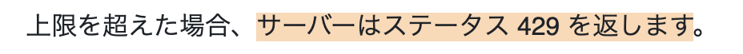
```


<a id="emoji"></a>
### Emoji in the quote

Emoji are kept and encoded in the link.

<details><summary>Input</summary>

```json
{
  "url": "http://127.0.0.1:4317/unicode.html",
  "quote": "Deploys are frozen on Fridays 🚫🚀 unless the release owner approves."
}
```

</details>

**match:** `exact` · **internal:** true · **link:** highlights the quote in Chromium

What the skill writes:

```md
[^emoji]: > Deploys are frozen on Fridays 🚫🚀 unless the release owner approves.
    >
    > — [レート制限](http://127.0.0.1:4317/unicode.html#:~:text=Deploys%20are%20frozen%20on%20Fridays%20%F0%9F%9A%AB%F0%9F%9A%80%20unless%20the%20release%20owner%20approves.) · retrieved 2026-11-08
```

## Loading the page

| Case | Result | Pass |
|---|---|---|
| [PDF](#pdf) | error | ✅ |
| [Page not found](#http-404) | error | ✅ |
| [Login wall](#login-wall) | error | ✅ |
| [Bot check](#bot-check) | error | ✅ |
| [Ordinary redirect](#redirect) | `exact` | ✅ |
| [🌐 http → https redirect](#http-to-https) | `exact`, occurrence 1 of 2 | ✅ |
| [Unreachable host](#unreachable) | error | ✅ |
| [Invalid option](#bad-option) | error | ✅ |

<a id="pdf"></a>
### PDF

Only HTML pages are supported. Claude marks the citation UNVERIFIED.

<details><summary>Input</summary>

```json
{
  "url": "http://127.0.0.1:4317/doc.pdf",
  "quote": "anything"
}
```

</details>

**error:** Not an HTML page (PDF or file download) - not supported; cite with a manual excerpt

<a id="http-404"></a>
### Page not found

HTTP errors are reported as errors, not as a missing quote.

<details><summary>Input</summary>

```json
{
  "url": "http://127.0.0.1:4317/missing.html",
  "quote": "anything"
}
```

</details>

**error:** HTTP 404

<a id="login-wall"></a>
### Login wall

The page loads but shows a sign-in form. Reported as a login wall so Claude doesn't claim the source lacks the quote.

<details><summary>Input</summary>

```json
{
  "url": "http://127.0.0.1:4317/login.html",
  "quote": "Internal roadmap for Q3"
}
```

</details>

**error:** Login wall: the page asks for a password and the quote is not visible - mark it UNVERIFIED

<a id="bot-check"></a>
### Bot check

A Cloudflare-style challenge page. Reported as a bot check, not a missing quote.

<details><summary>Input</summary>

```json
{
  "url": "http://127.0.0.1:4317/challenge.html",
  "quote": "anything at all here"
}
```

</details>

**error:** Bot check (e.g. Cloudflare) blocked the page - the quote could not be checked; mark it UNVERIFIED

<a id="redirect"></a>
### Ordinary redirect

Moved pages are followed.

<details><summary>Input</summary>

```json
{
  "url": "http://127.0.0.1:4317/redirect",
  "quote": "Every API key has a request budget that refills continuously."
}
```

</details>

**match:** `exact` · **internal:** true · **link:** highlights the quote in Chromium

What the skill writes:

```md
[^redirect]: > Every API key has a request budget that refills continuously.
    >
    > — [Rate limiting guide — Overview](http://127.0.0.1:4317/redirect#:~:text=Every%20API%20key%20has%20a%20request%20budget%20that%20refills%20continuously.) · retrieved 2026-11-08
```

<a id="http-to-https"></a>
### 🌐 http → https redirect

Most sites redirect plain http.

<details><summary>Input</summary>

```json
{
  "url": "http://en.wikipedia.org/wiki/Justin_Bieber",
  "quote": "best-selling music artists of all time"
}
```

</details>

**match:** `exact` · **occurrence:** 1 of 2 · **link:** highlights the quote in Chromium

**note:** Quote appears 2 times; matched the first. If you meant another, re-run with prefix/suffix (words just before/after it).

What the skill writes:

```md
[^http-to-https]: > best-selling music artists of all time
    >
    > — [Justin Bieber - Wikipedia](http://en.wikipedia.org/wiki/Justin_Bieber#:~:text=one%20of%20the-,best%2Dselling%20music%20artists%20of%20all%20time,-.) · retrieved 2026-11-08
```

<a id="unreachable"></a>
### Unreachable host

Connection refused. Reported as an error; the rest of the batch still finishes.

<details><summary>Input</summary>

```json
{
  "url": "http://127.0.0.1:9/",
  "quote": "anything"
}
```

</details>

**error:** page.goto: net::ERR_CONNECTION_REFUSED at http://127.0.0.1:9/

<a id="bad-option"></a>
### Invalid option

Bad option values are errors, not silently replaced with defaults.

<details><summary>Input</summary>

```json
{
  "url": "http://127.0.0.1:4317/article.html",
  "quote": "anything",
  "frame": "huge"
}
```

</details>

**error:** frame must be one of quote, paragraph, section, viewport (got "huge")

## URL safety

| Case | Result | Pass |
|---|---|---|
| [file:// URL](#file-url) | error | ✅ |
| [Cloud metadata address, written as a number](#metadata-decimal) | error | ✅ |
| [Cloud metadata address inside IPv6](#metadata-ipv6) | error | ✅ |
| [Redirect to the metadata address](#metadata-redirect) | error | ✅ |
| [localhost is allowed](#localhost) | `exact` | ✅ |

<a id="file-url"></a>
### file:// URL

Local files must never be quoted, even if a web page tricks Claude into trying.

<details><summary>Input</summary>

```json
{
  "url": "file:///etc/hosts",
  "quote": "localhost"
}
```

</details>

**error:** Blocked URL scheme file: (only http/https pages can be cited)

<a id="metadata-decimal"></a>
### Cloud metadata address, written as a number

2852039166 is 169.254.169.254.

<details><summary>Input</summary>

```json
{
  "url": "http://2852039166/latest/meta-data/",
  "quote": "ami-id"
}
```

</details>

**error:** Blocked host 169.254.169.254 (cloud metadata / link-local)

<a id="metadata-ipv6"></a>
### Cloud metadata address inside IPv6

The NAT64 form of 169.254.169.254.

<details><summary>Input</summary>

```json
{
  "url": "http://[64:ff9b::a9fe:a9fe]/",
  "quote": "ami-id"
}
```

</details>

**error:** Blocked host 64:ff9b::a9fe:a9fe (cloud metadata / link-local)

<a id="metadata-redirect"></a>
### Redirect to the metadata address

Each redirect is checked before the browser follows it, and the error names the real reason.

<details><summary>Input</summary>

```json
{
  "url": "http://127.0.0.1:4317/redirect-metadata",
  "quote": "ami-id"
}
```

</details>

**error:** Blocked host 169.254.169.254 (cloud metadata / link-local) (reached via redirect from http://127.0.0.1:4317/redirect-metadata)

<a id="localhost"></a>
### localhost is allowed

On purpose: internal docs on your network are a core use case. The result is flagged `internal`, so Claude treats the content as possibly confidential and quotes only what the claim needs. Every fixture page here is served from localhost.

<details><summary>Input</summary>

```json
{
  "url": "http://127.0.0.1:4317/article.html",
  "quote": "When a client exceeds its budget"
}
```

</details>

**match:** `exact` · **internal:** true · **link:** highlights the quote in Chromium

What the skill writes:

```md
[^localhost]: > When a client exceeds its budget
    >
    > — [Rate limiting guide — Overview](http://127.0.0.1:4317/article.html#:~:text=When%20a%20client%20exceeds%20its%20budget) · retrieved 2026-11-08
```

## Screenshot controls

| Case | Prompt wording | Pass |
|---|---|---|
| [Default: the paragraph](#frame-paragraph) | (no wording needed) | ✅ |
| [frame: quote](#frame-quote) | "tight screenshots" | ✅ |
| [frame: section](#frame-section) | "show the whole section" | ✅ |
| [frame: viewport](#frame-viewport) | "full-screen screenshots" | ✅ |
| [context: 2](#context-lines) | "include a couple of lines around it" | ✅ |
| [width: 390](#phone-width) | "mobile-sized screenshots" | ✅ |
| [max_height: 120](#max-height) | "keep them short" | ✅ |
| [highlight: yellow](#highlight-color) | "highlight in yellow" | ✅ |
| [highlight: none](#highlight-none) | "no highlight" | ✅ |
| [theme: dark](#theme-dark) | "dark mode screenshots" | ✅ |
| [scale: 1](#scale-1) | "smaller images" | ✅ |
| [frame: section on a page without headings](#section-no-heading) |  | ✅ |
| [frame: viewport on a very short page](#viewport-short-page) |  | ✅ |
| [theme: dark on a site without dark mode](#dark-unsupported) |  | ✅ |
| [Quote in a wide table](#wide-table) |  | ✅ |
| [🌐 Page that keeps shifting while loading](#tall-block-shift) |  | ✅ |

<a id="frame-paragraph"></a>
### Default: the paragraph

The default frame is the paragraph containing the quote.

Prompt wording: (no wording needed)

<details><summary>Input</summary>

```json
{
  "url": "http://127.0.0.1:4317/article.html",
  "quote": "Clients should wait for the number of seconds given in the Retry-After header before retrying.",
  "out": "refs/frame-paragraph.png"
}
```

</details>

**match:** `exact` · **internal:** true · **link:** highlights the quote in Chromium

What the skill writes:

```md
[^frame-paragraph]: > Clients should wait for the number of seconds given in the Retry-After header before retrying.
    >
    > — [Rate limiting guide — Retry behaviour](http://127.0.0.1:4317/article.html#:~:text=Clients%20should%20wait%20for%20the%20number%20of%20seconds%20given%20in%20the%20Retry%2DAfter%20header%20before%20retrying.) · retrieved 2026-11-08
    >
    > 
```


<a id="frame-quote"></a>
### frame: quote

Only the lines the quote is on.

Prompt wording: "tight screenshots"

<details><summary>Input</summary>

```json
{
  "url": "http://127.0.0.1:4317/article.html",
  "quote": "Clients should wait for the number of seconds given in the Retry-After header before retrying.",
  "out": "refs/frame-quote.png",
  "frame": "quote"
}
```

</details>

**match:** `exact` · **internal:** true · **link:** highlights the quote in Chromium

What the skill writes:

```md
[^frame-quote]: > Clients should wait for the number of seconds given in the Retry-After header before retrying.
    >
    > — [Rate limiting guide — Retry behaviour](http://127.0.0.1:4317/article.html#:~:text=Clients%20should%20wait%20for%20the%20number%20of%20seconds%20given%20in%20the%20Retry%2DAfter%20header%20before%20retrying.) · retrieved 2026-11-08
    >
    > 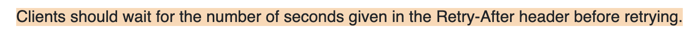
```


<a id="frame-section"></a>
### frame: section

From the nearest heading above the quote to the next heading.

Prompt wording: "show the whole section"

<details><summary>Input</summary>

```json
{
  "url": "http://127.0.0.1:4317/article.html",
  "quote": "Clients should wait for the number of seconds given in the Retry-After header before retrying.",
  "out": "refs/frame-section.png",
  "frame": "section"
}
```

</details>

**match:** `exact` · **internal:** true · **link:** highlights the quote in Chromium

What the skill writes:

```md
[^frame-section]: > Clients should wait for the number of seconds given in the Retry-After header before retrying.
    >
    > — [Rate limiting guide — Retry behaviour](http://127.0.0.1:4317/article.html#:~:text=Clients%20should%20wait%20for%20the%20number%20of%20seconds%20given%20in%20the%20Retry%2DAfter%20header%20before%20retrying.) · retrieved 2026-11-08
    >
    > 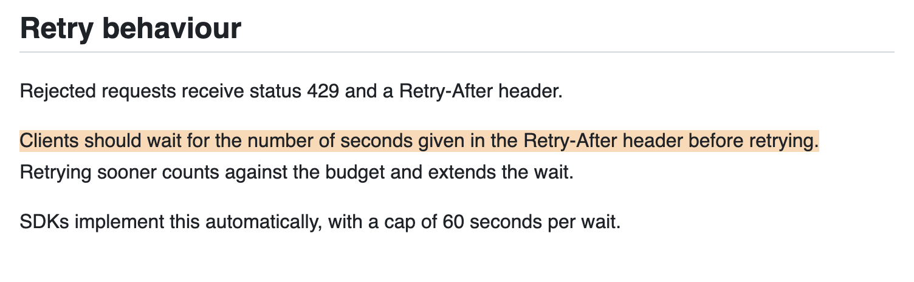
```


<a id="frame-viewport"></a>
### frame: viewport

The whole browser window, centered on the quote.

Prompt wording: "full-screen screenshots"

<details><summary>Input</summary>

```json
{
  "url": "http://127.0.0.1:4317/article.html",
  "quote": "Clients should wait for the number of seconds given in the Retry-After header before retrying.",
  "out": "refs/frame-viewport.png",
  "frame": "viewport",
  "max_height": 600
}
```

</details>

**match:** `exact` · **internal:** true · **link:** highlights the quote in Chromium

What the skill writes:

```md
[^frame-viewport]: > Clients should wait for the number of seconds given in the Retry-After header before retrying.
    >
    > — [Rate limiting guide — Retry behaviour](http://127.0.0.1:4317/article.html#:~:text=Clients%20should%20wait%20for%20the%20number%20of%20seconds%20given%20in%20the%20Retry%2DAfter%20header%20before%20retrying.) · retrieved 2026-11-08
    >
    > 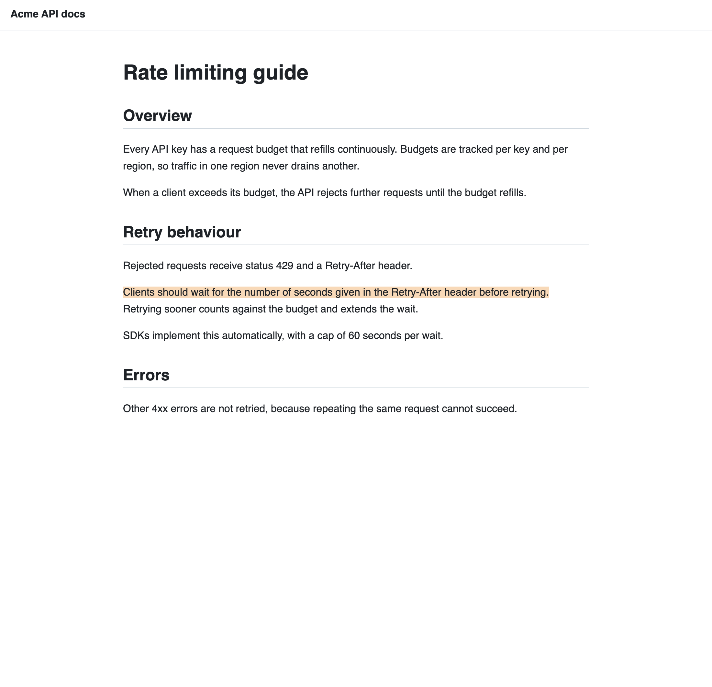
```


<a id="context-lines"></a>
### context: 2

Extra lines above and below the frame.

Prompt wording: "include a couple of lines around it"

<details><summary>Input</summary>

```json
{
  "url": "http://127.0.0.1:4317/article.html",
  "quote": "Clients should wait for the number of seconds given in the Retry-After header before retrying.",
  "out": "refs/context-lines.png",
  "frame": "quote",
  "context": 2
}
```

</details>

**match:** `exact` · **internal:** true · **link:** highlights the quote in Chromium

What the skill writes:

```md
[^context-lines]: > Clients should wait for the number of seconds given in the Retry-After header before retrying.
    >
    > — [Rate limiting guide — Retry behaviour](http://127.0.0.1:4317/article.html#:~:text=Clients%20should%20wait%20for%20the%20number%20of%20seconds%20given%20in%20the%20Retry%2DAfter%20header%20before%20retrying.) · retrieved 2026-11-08
    >
    > 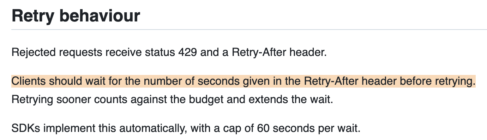
```


<a id="phone-width"></a>
### width: 390

Phone-width browser; the quote wraps onto more lines.

Prompt wording: "mobile-sized screenshots"

<details><summary>Input</summary>

```json
{
  "url": "http://127.0.0.1:4317/article.html",
  "quote": "Clients should wait for the number of seconds given in the Retry-After header before retrying.",
  "out": "refs/phone-width.png",
  "width": 390
}
```

</details>

**match:** `exact` · **internal:** true · **link:** highlights the quote in Chromium

What the skill writes:

```md
[^phone-width]: > Clients should wait for the number of seconds given in the Retry-After header before retrying.
    >
    > — [Rate limiting guide — Retry behaviour](http://127.0.0.1:4317/article.html#:~:text=Clients%20should%20wait%20for%20the%20number%20of%20seconds%20given%20in%20the%20Retry%2DAfter%20header%20before%20retrying.) · retrieved 2026-11-08
    >
    > 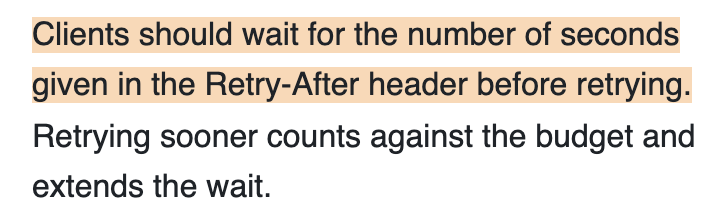
```


<a id="max-height"></a>
### max_height: 120

A section frame capped at 120 px, centered on the quote.

Prompt wording: "keep them short"

<details><summary>Input</summary>

```json
{
  "url": "http://127.0.0.1:4317/article.html",
  "quote": "Clients should wait for the number of seconds given in the Retry-After header before retrying.",
  "out": "refs/max-height.png",
  "frame": "section",
  "max_height": 120
}
```

</details>

**match:** `exact` · **internal:** true · **link:** highlights the quote in Chromium

What the skill writes:

```md
[^max-height]: > Clients should wait for the number of seconds given in the Retry-After header before retrying.
    >
    > — [Rate limiting guide — Retry behaviour](http://127.0.0.1:4317/article.html#:~:text=Clients%20should%20wait%20for%20the%20number%20of%20seconds%20given%20in%20the%20Retry%2DAfter%20header%20before%20retrying.) · retrieved 2026-11-08
    >
    > 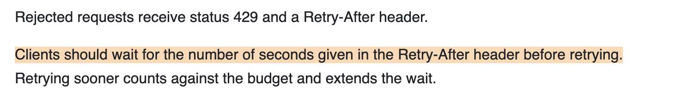
```


<a id="highlight-color"></a>
### highlight: yellow

Any CSS color works.

Prompt wording: "highlight in yellow"

<details><summary>Input</summary>

```json
{
  "url": "http://127.0.0.1:4317/article.html",
  "quote": "Clients should wait for the number of seconds given in the Retry-After header before retrying.",
  "out": "refs/highlight-color.png",
  "highlight": "#fff3a0"
}
```

</details>

**match:** `exact` · **internal:** true · **link:** highlights the quote in Chromium

What the skill writes:

```md
[^highlight-color]: > Clients should wait for the number of seconds given in the Retry-After header before retrying.
    >
    > — [Rate limiting guide — Retry behaviour](http://127.0.0.1:4317/article.html#:~:text=Clients%20should%20wait%20for%20the%20number%20of%20seconds%20given%20in%20the%20Retry%2DAfter%20header%20before%20retrying.) · retrieved 2026-11-08
    >
    > 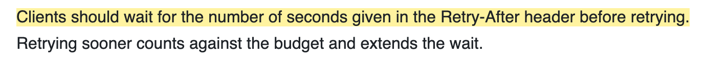
```


<a id="highlight-none"></a>
### highlight: none

Plain screenshot of the frame.

Prompt wording: "no highlight"

<details><summary>Input</summary>

```json
{
  "url": "http://127.0.0.1:4317/article.html",
  "quote": "Clients should wait for the number of seconds given in the Retry-After header before retrying.",
  "out": "refs/highlight-none.png",
  "highlight": "none"
}
```

</details>

**match:** `exact` · **internal:** true · **link:** highlights the quote in Chromium

What the skill writes:

```md
[^highlight-none]: > Clients should wait for the number of seconds given in the Retry-After header before retrying.
    >
    > — [Rate limiting guide — Retry behaviour](http://127.0.0.1:4317/article.html#:~:text=Clients%20should%20wait%20for%20the%20number%20of%20seconds%20given%20in%20the%20Retry%2DAfter%20header%20before%20retrying.) · retrieved 2026-11-08
    >
    > 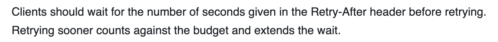
```


<a id="theme-dark"></a>
### theme: dark

Uses the site's own dark theme; highlighted text switches to dark ink so it stays readable.

Prompt wording: "dark mode screenshots"

<details><summary>Input</summary>

```json
{
  "url": "http://127.0.0.1:4317/article.html",
  "quote": "Clients should wait for the number of seconds given in the Retry-After header before retrying.",
  "out": "refs/theme-dark.png",
  "theme": "dark"
}
```

</details>

**match:** `exact` · **internal:** true · **link:** highlights the quote in Chromium

**note:** Page has no dark mode; the screenshot uses its light theme.

What the skill writes:

```md
[^theme-dark]: > Clients should wait for the number of seconds given in the Retry-After header before retrying.
    >
    > — [Rate limiting guide — Retry behaviour](http://127.0.0.1:4317/article.html#:~:text=Clients%20should%20wait%20for%20the%20number%20of%20seconds%20given%20in%20the%20Retry%2DAfter%20header%20before%20retrying.) · retrieved 2026-11-08
    >
    > 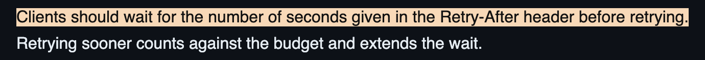
```


<a id="scale-1"></a>
### scale: 1

Standard resolution: about a quarter of the pixels of the default 2×.

Prompt wording: "smaller images"

<details><summary>Input</summary>

```json
{
  "url": "http://127.0.0.1:4317/article.html",
  "quote": "Clients should wait for the number of seconds given in the Retry-After header before retrying.",
  "out": "refs/scale-1.png",
  "scale": 1
}
```

</details>

**match:** `exact` · **internal:** true · **link:** highlights the quote in Chromium

What the skill writes:

```md
[^scale-1]: > Clients should wait for the number of seconds given in the Retry-After header before retrying.
    >
    > — [Rate limiting guide — Retry behaviour](http://127.0.0.1:4317/article.html#:~:text=Clients%20should%20wait%20for%20the%20number%20of%20seconds%20given%20in%20the%20Retry%2DAfter%20header%20before%20retrying.) · retrieved 2026-11-08
    >
    > 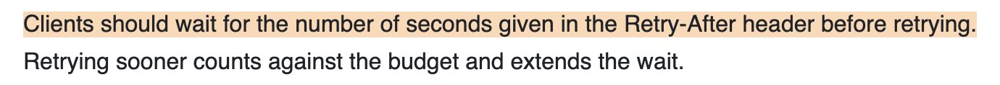
```


<a id="section-no-heading"></a>
### frame: section on a page without headings

Falls back to the paragraph and says so.

<details><summary>Input</summary>

```json
{
  "url": "http://127.0.0.1:4317/no-headings.html",
  "quote": "The rate limiter now refills budgets every second",
  "out": "refs/section-no-heading.png",
  "frame": "section"
}
```

</details>

**match:** `exact` · **internal:** true · **link:** highlights the quote in Chromium

**note:** No heading above the quote; used the paragraph frame.

What the skill writes:

```md
[^section-no-heading]: > The rate limiter now refills budgets every second
    >
    > — [Changelog note](http://127.0.0.1:4317/no-headings.html#:~:text=The%20rate%20limiter%20now%20refills%20budgets%20every%20second) · retrieved 2026-11-08
    >
    > 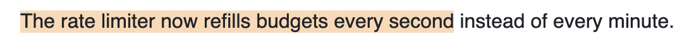
```


<a id="viewport-short-page"></a>
### frame: viewport on a very short page

The page is shorter than the window; the capture stops at the page's end.

<details><summary>Input</summary>

```json
{
  "url": "http://127.0.0.1:4317/short.html",
  "quote": "The legacy v1 endpoints will be removed",
  "out": "refs/viewport-short-page.png",
  "frame": "viewport",
  "max_height": 300
}
```

</details>

**match:** `exact` · **internal:** true · **link:** highlights the quote in Chromium

What the skill writes:

```md
[^viewport-short-page]: > The legacy v1 endpoints will be removed
    >
    > — [Notice](http://127.0.0.1:4317/short.html#:~:text=The%20legacy%20v1%20endpoints%20will%20be%20removed) · retrieved 2026-11-08
    >
    > 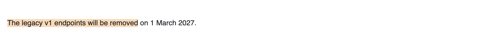
```


<a id="dark-unsupported"></a>
### theme: dark on a site without dark mode

Pages can't be forced dark; the screenshot stays light and the result says so.

<details><summary>Input</summary>

```json
{
  "url": "http://127.0.0.1:4317/short.html",
  "quote": "The legacy v1 endpoints will be removed",
  "out": "refs/dark-unsupported.png",
  "theme": "dark"
}
```

</details>

**match:** `exact` · **internal:** true · **link:** highlights the quote in Chromium

**note:** Page has no dark mode; the screenshot uses its light theme.

What the skill writes:

```md
[^dark-unsupported]: > The legacy v1 endpoints will be removed
    >
    > — [Notice](http://127.0.0.1:4317/short.html#:~:text=The%20legacy%20v1%20endpoints%20will%20be%20removed) · retrieved 2026-11-08
    >
    > 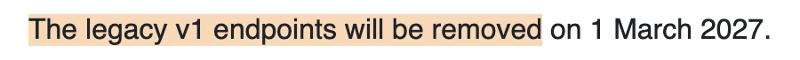
```


<a id="wide-table"></a>
### Quote in a wide table

Frames the whole row so the value keeps its context. The table is wider than the window, so the crop centers horizontally on the quote.

<details><summary>Input</summary>

```json
{
  "url": "http://127.0.0.1:4317/table.html",
  "quote": "Burst limit: 200 requests per second",
  "out": "refs/wide-table.png"
}
```

</details>

**match:** `exact` · **internal:** true · **link:** highlights the quote in Chromium

What the skill writes:

```md
[^wide-table]: > Burst limit: 200 requests per second
    >
    > — [Plan limits](http://127.0.0.1:4317/table.html#:~:text=Burst%20limit%3A%20200%20requests%20per%20second) · retrieved 2026-11-08
    >
    > 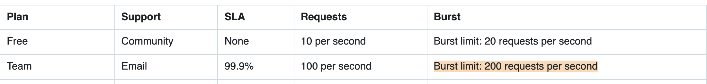
```


<a id="tall-block-shift"></a>
### 🌐 Page that keeps shifting while loading

RFC 9110 reflows as fonts and styles arrive. The script waits until the quote stops moving before capturing.

<details><summary>Input</summary>

```json
{
  "url": "https://www.rfc-editor.org/rfc/rfc9110.html",
  "quote": "Retry-After = HTTP-date / delay-seconds",
  "out": "refs/tall-block-shift.png"
}
```

</details>

**match:** `exact` · **occurrence:** 1 of 2 · **link:** highlights the quote in Chromium

**note:** Quote appears 2 times; matched the first. If you meant another, re-run with prefix/suffix (words just before/after it).

What the skill writes:

```md
[^tall-block-shift]: > Retry-After = HTTP-date / delay-seconds
    >
    > — [RFC 9110: HTTP Semantics — 10.2.3. Retry-After](https://www.rfc-editor.org/rfc/rfc9110.html#:~:text=Retry%2DAfter%20%3D%20HTTP%2Ddate%20%2F%20delay%2Dseconds) · retrieved 2026-11-08
    >
    > 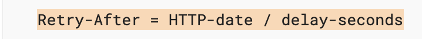
```


